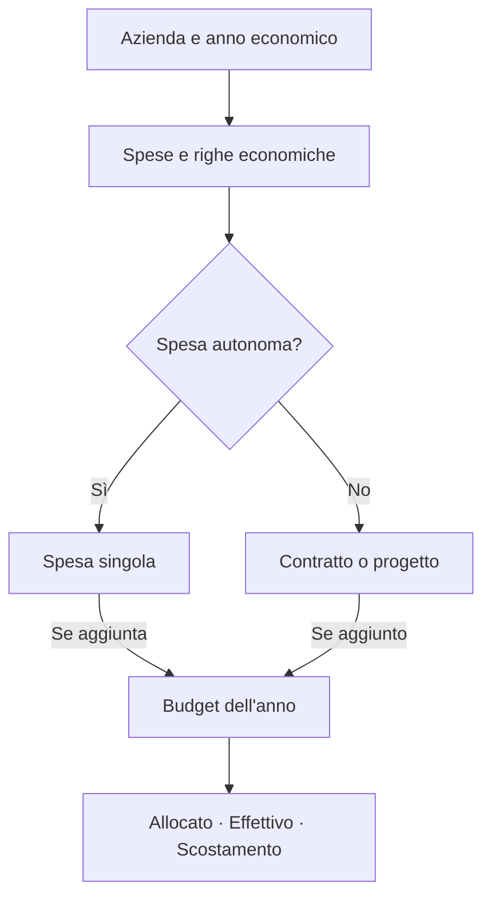

  <picture>
    <source media="(prefers-color-scheme: dark)" srcset="public/branding/obake-logo-white.svg">
    <source media="(prefers-color-scheme: light)" srcset="public/branding/obake-logo-black.svg">
    
  </picture>

  <h1>Obake</h1>

  
<strong>Dal budget alla spesa effettiva, con tutto il contesto a portata di mano.</strong>

  
Un'applicazione web per organizzare spese, budget, contratti e progetti 
  e confrontare ciò che era previsto con ciò che è stato registrato.

  

    <a href="#come-funziona">Come funziona</a> ·
    <a href="#funzionalità">Funzionalità</a> ·
    <a href="#iniziare">Iniziare</a> ·
    <a href="#documentazione">Documentazione</a>
  

  

    
  

---

## Cos'è Obake

Obake è uno strumento di **gestione e controllo economico**: raccoglie le informazioni sulle spese di un'azienda, le organizza per anno e permette di costruire un Budget leggibile senza duplicare gli importi.

L'obiettivo non è soltanto registrare un numero, ma conservarne il contesto: a quale progetto o contratto si riferisce, quale fornitore coinvolge, in quale anno va considerato e come cambia il confronto tra previsione e consuntivo.

Ogni **Azienda** ha i propri dati, utenti e impostazioni. Le funzioni trasversali sono raccolte nell'area **Amministrazione**, accessibile soltanto agli utenti autorizzati.

## Come funziona

Il modello parte dalle **spese**. Una spesa può essere autonoma oppure appartenere a **un contratto o un progetto**; questi ultimi sono contenitori che raggruppano le spese, non costi aggiuntivi da sommare una seconda volta.

Il **Budget di un anno** è una selezione esplicita di spese autonome, contratti e progetti. Aggiungere un contenitore al Budget considera le spese attribuite a quel contenitore nell'anno; le altre spese rimangono consultabili nell'applicazione, ma non entrano automaticamente nei totali del Budget.

### I tre importi da conoscere

| Voce | Significato |
| --- | --- |
| **Allocato** | La previsione economica registrata per una spesa. |
| **Effettivo** | L'importo effettivamente registrato. Non equivale necessariamente a un pagamento effettuato. |
| **Scostamento** | **Effettivo − Allocato**. Positivo indica una spesa superiore alla previsione; negativo una spesa inferiore. |

Esempio:

| Spesa | Allocato | Effettivo | Scostamento |
| --- | ---: | ---: | ---: |
| Servizi cloud | 1.200 € | 1.450 € | 250 € (eccedenza) |
| Attrezzature | 2.000 € | 1.800 € | −200 € (risparmio) |

**Zero e valore non inserito non sono la stessa cosa.** Un importo `0` è una registrazione esplicita; un campo vuoto indica che quel valore non è stato ancora definito. Le righe economiche possono dettagliare descrizione, quantità, prezzo e attribuzione annuale.

### Contratti, progetti e Budget

- **Spese:** rappresentano i costi da pianificare e rendicontare. Possono avere righe economiche, fornitore, note, centro di costo, allegati e commenti.
- **Contratti:** raggruppano spese e permettono di tenere sotto controllo periodi, scadenze e promemoria. L'importo di riferimento del contratto è distinto dai valori delle spese collegate.
- **Progetti:** raggruppano spese e ne permettono la lettura per iniziativa, con stati personalizzabili.
- **Budget:** decide quali spese autonome o contenitori partecipano ai totali dell'anno. Una stessa spesa non viene conteggiata due volte perché è collegata a un contratto o a un progetto.

## Funzionalità

| Ambito | Cosa puoi fare |
| --- | --- |
| **Budget annuale** | Comporre il Budget, individuare voci mancanti, analizzare allocato, effettivo e scostamenti. |
| **Spese e righe economiche** | Registrare importi, dettagli, periodi, anni di attribuzione e collegamenti con contratti o progetti. |
| **Contratti** | Organizzare le spese collegate, consultare lo scadenzario e configurare promemoria via email. |
| **Progetti** | Gestire iniziative, spese associate e stati configurabili per Azienda. |
| **Fornitori e centri di costo** | Classificare e consultare le informazioni economiche da prospettive diverse. |
| **Ricerca e report** | Filtrare le tabelle, importare/esportare Excel, predisporre report e stamparli o scaricarli in PDF. |
| **Collaborazione** | Invitare utenti, assegnare accessi, inserire commenti, gestire allegati e annullare operazioni supportate. |
| **Accesso e sicurezza** | Separazione dei dati per Azienda, ruoli amministrativi, passkey e autenticazione TOTP. |
| **Backup e Google Drive** | Creare backup locali, ripristinare dati nei flussi previsti e sincronizzare report annuali Excel su Drive. |

## Un possibile flusso di lavoro

1. In **Amministrazione** si crea l'Azienda e si assegnano gli utenti autorizzati.
2. Nell'Azienda si seleziona l'**anno economico** e si registrano le spese, eventualmente suddivise in righe economiche.
3. Se utile, si collegano le spese a un **contratto** o a un **progetto**. Altrimenti restano autonome.
4. Nel **Budget** si aggiungono le voci che devono contribuire alla previsione e al consuntivo dell'anno.
5. Si usano **panoramica, filtri e report** per seguire l'andamento dei costi e approfondire gli scostamenti.

Non è necessario creare prima un contratto o un progetto per inserire una spesa, né includere ogni spesa nel Budget.

## Iniziare

Obake può essere eseguito in un ambiente di sviluppo con Docker oppure installato su un sito PHP, ad esempio con **CloudPanel**, usando lo ZIP di produzione generato da GitHub Actions.

| Scenario | Guida |
| --- | --- |
| **Nuova installazione su CloudPanel** | [Installazione da zero con ZIP di produzione](docs/guida-tecnica.md#installazione-su-cloudpanel-da-zero-senza-docker) |
| **Aggiornamento di un sito esistente** | [CI, artifact verificati e deploy](docs/guida-tecnica.md#aggiornare-un-sito-esistente-con-github-actions) |
| **Sviluppo locale** | [Ambiente Docker e comandi di sviluppo](docs/guida-tecnica.md#sviluppo-con-docker) |
| **Verifiche e build** | [Comandi per test e controlli](docs/guida-tecnica.md#controlli-e-build) |

> **Installazione:** il pacchetto pronto per CloudPanel si scarica dal workflow [Production ZIP](https://github.com/Capobuf/obake/actions/workflows/production-zip.yml), non da **Code → Download ZIP**. Per la prima installazione sono richiesti un database vuoto e un runtime PHP compatibile; seguire la guida prima di eseguire comandi sul server.

### Tecnologie

Il progetto utilizza **Laravel 13**, **PHP 8.4.27+ o 8.5.12+**, **React 19**, **TypeScript**, **Inertia.js 3**, **Tailwind CSS 4** e componenti **shadcn/ui**. I dati sono gestiti in **MySQL**; build, test e pacchetti di distribuzione sono gestiti con **GitHub Actions**.

In produzione il frontend viene distribuito già compilato: non è necessario mantenere un server Node.js in esecuzione.

## Documentazione

| Documento | Contenuto |
| --- | --- |
| [Guida tecnica e operativa](docs/guida-tecnica.md) | Installazione, deploy, sviluppo, configurazioni, backup, sincronizzazione e note operative dettagliate. |
| [Importazione ed esportazione dati](docs/data-transfer.md) | Excel, CSV tecnico, modelli di importazione, annualità e regole di validazione. |
| [Multi-azienda](MULTITENANCY.md) | Struttura di isolamento e accesso ai dati delle Aziende. |

Per segnalazioni e proposte di miglioramento è disponibile la sezione [Issues](https://github.com/Capobuf/obake/issues).

---

  Obake · Gestione economica per Azienda e anno

